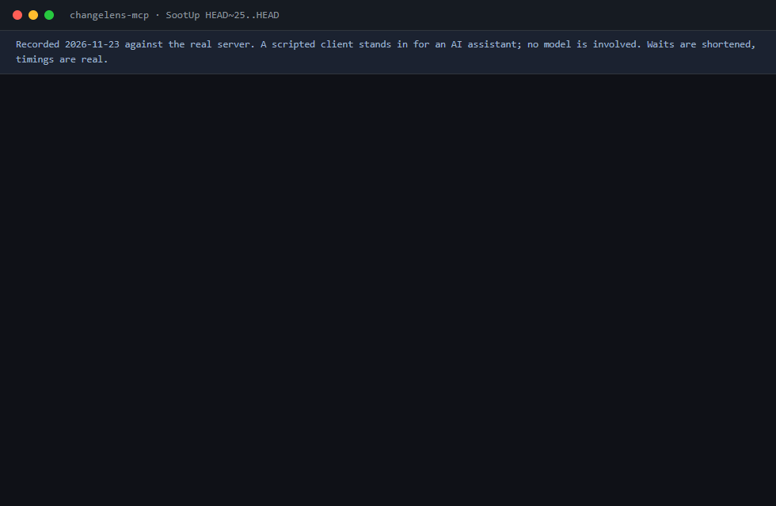

# ChangeLens

**See what a pull request really does, not just which lines changed.**

ChangeLens reads the code of a Java pull request with a real parser and tells the reviewer, at every level: which packages, classes and methods changed, what the new behaviour is (new branches, new calls, new exceptions), which **existing endpoints** run through the changed code, and what is only a move, a rename or a reformat. It posts that as one comment on the PR, with a diagram.

It does not guess and the analysis never uses an AI model: every statement comes from analysing the code. AI assistants can use that analysis through [MCP](#use-it-from-an-ai-assistant-mcp), and it stays checkable when they do.

## Why

Reviewing is mostly *understanding the change*. Microsoft's study of code review found that [change understanding is the key challenge](https://microsoft.com/en-us/research/?p=164195), and that tools barely support it. AI-written code makes it harder: it compiles and looks tidy, so the question becomes "what does this actually do?". A red and green diff does not answer that. See [docs/RESEARCH.md](docs/RESEARCH.md).

## Example

This is the real output for a real commit in [spring-petclinic](https://github.com/spring-projects/spring-petclinic) ("Enforce unique pet names per owner"):

> **4 Java files** | 1 new classes, 0 removed, 4 changed, 0 moved or renamed | **9 methods with new or changed logic** | 0 safe to skim
>
> ### Read these first
>
> 1. `PetController.processCreationForm(Owner, Pet, BindingResult, RedirectAttributes)`: new try; new if `!isDuplicatePetNameViolation(ex)`; now throws ex; now calls `OwnerRepository.saveAndFlush`, `PetController.isDuplicatePetNameViolation`, `BindingResult.rejectValue`; no longer calls `OwnerRepository.save`
> 2. `PetController.processUpdateForm(Owner, Pet, BindingResult, RedirectAttributes)`: new try; new if `!isDuplicatePetNameViolation(ex)`; now throws ex; now calls `PetController.isDuplicatePetNameViolation`, `BindingResult.rejectValue`
> 3. `PetController.updatePetDetails(Owner, Pet)`: now calls `OwnerRepository.saveAndFlush`; no longer calls `OwnerRepository.save`
> 4. `PetController.isDuplicatePetNameViolation(DataIntegrityViolationException)`: new method
>
> ### Existing features this change runs through
>
> - **`POST /owners/{ownerId}/pets/new`** reaches `PetController.processCreationForm` (the endpoint method itself changed)
> - **`POST /owners/{ownerId}/pets/{petId}/edit`** reaches `PetController.processUpdateForm` (the endpoint method itself changed)
>
> ### Map
>
> ```mermaid
> flowchart LR
>   subgraph P1["petclinic.owner"]
>     T1["PetController<br/>4 logic changes"]:::changed
>   end
>   E1(["POST /owners/(ownerId)/pets/new"]):::entry
>   E2(["POST /owners/(ownerId)/pets/(petId)/edit"]):::entry
>   E1 --> T1
>   E2 --> T1
>   classDef added fill:#d4f5dd,stroke:#2e8b57,color:#111;
>   classDef removed fill:#ffd9d9,stroke:#c0392b,color:#111;
>   classDef changed fill:#fff1c2,stroke:#d4a017,color:#111;
>   classDef moved fill:#d9e8ff,stroke:#3b6fd4,color:#111;
>   classDef quiet fill:#eeeeee,stroke:#999,color:#111;
>   classDef ctx fill:#ffffff,stroke:#999,stroke-dasharray:3 3,color:#111;
>   classDef entry fill:#e8e0ff,stroke:#6a4fd4,color:#111;
> ```
>
> <details><summary>Unchanged code that depends on changed code (4)</summary>
>
>
> </details>
>
>

## Use it in your repository (2 minutes)

Create `.github/workflows/changelens.yml`:

```yaml
name: ChangeLens
on:
  pull_request:
    paths: ["**.java"]

permissions:
  contents: read
  pull-requests: write   # so ChangeLens can post its comment

jobs:
  explain:
    runs-on: ubuntu-latest
    steps:
      - uses: actions/checkout@v4
        with:
          fetch-depth: 0   # ChangeLens reads the base and head commits from git history
      - uses: vaibhavgupta443/changelens@v0.1.2
```

Open a pull request that changes Java code. ChangeLens posts one comment and keeps it updated on every push. The full report is also in the job summary.

| Input | Default | Meaning |
|---|---|---|
| `comment` | `true` | Post and update a PR comment. `false` = job summary only. |
| `version` | `latest` | Which ChangeLens release to use, for example `v0.1.2`. |
| `max-chars` | `60000` | Comment length limit (GitHub allows 65,536). |

**Safe by design.** ChangeLens only *parses* your code. It never builds or runs it, makes no network calls while analysing, and needs no secrets. Use the `pull_request` event (as above), not `pull_request_target`. For pull requests from forks GitHub gives a read-only token, so the comment is skipped and the report appears in the job summary instead.

## Use it on your own machine

```bash
# download changelens-cli.jar from the latest release, then, inside any git repository:
java -jar changelens-cli.jar --repo . --base origin/main --head HEAD
```

Options: `--format pr-comment|markdown`, `--max-chars N`, `--out report.md`. Needs Java 21.

## Run it as a service (REST API)

The same engine is available as a Spring Boot service that stores every analysis, so a team can ask "what did this change do?" without running a CLI.

```bash
cd backend
CHANGELENS_WORKSPACE=/path/to/folder-with-your-repos ./mvnw spring-boot:run
```

```bash
# start an analysis of two revisions of the repository folder "my-app" (202 Accepted + Location header)
curl -X POST localhost:8080/api/analyses -H 'Content-Type: application/json' \
     -d '{"repo":"my-app","base":"origin/main","head":"HEAD"}'

curl localhost:8080/api/analyses/<id>                       # status, timings, counts
curl "localhost:8080/api/analyses/<id>/report?format=markdown"   # or format=pr-comment
curl "localhost:8080/api/analyses?size=20"                  # recent analyses, newest first
```

- A request names a repository **folder inside the workspace**, never a path. Names such as `../x` and revisions that could be read as git options are rejected, and the resolved path is checked again to stay inside the workspace.
- Analyses run on a small worker pool with a bounded queue (`changelens.workers`, `changelens.queue`); when it is full the API answers `429` instead of growing without limit. A run interrupted by a restart is marked `FAILED`.
- Results are stored with JPA in a local H2 file by default. Set `CHANGELENS_DB_URL` (and the usual `spring.datasource.*` settings) to use PostgreSQL.
- Errors are RFC 7807 problem documents.

## Use it from an AI assistant (MCP)

ChangeLens is also a [Model Context Protocol](https://modelcontextprotocol.io) server. An assistant such as Claude Desktop, Claude Code or Cursor can ask it what a change does and get answers computed from the code, not guessed, with ids it can cite and ids you can check.



*Recorded against the real server on [SootUp](https://github.com/soot-oss/SootUp) (9,600 commits). A scripted client stands in for the assistant, so the recording shows the tools and no model. Waits are shortened; the timings on screen are real.*

```bash
cd backend
./mvnw -P mcp -DskipTests package            # target/changelens-mcp.jar           about 11 MB, keyword search
./mvnw -P mcp-semantic -DskipTests package   # target/changelens-mcp-semantic.jar  about 126 MB, adds search by meaning
```

Point your client at the jar and at the folder that holds your repositories:

```json
{ "mcpServers": { "changelens": { "command": "java",
  "args": ["-jar", "/path/to/changelens-mcp-semantic.jar", "/path/to/folder-with-your-repos"] } } }
```

In Claude Code: `claude mcp add changelens -- java -jar /path/to/changelens-mcp-semantic.jar /path/to/folder-with-your-repos`

| Tool | What it answers |
|---|---|
| `list_repositories` | Which repositories (folder names) the server may read |
| `analyze_change` | Compare two revisions; returns an `analysisId` and the overview |
| `get_overview` | Counts: new or changed logic, endpoints affected, changed methods no test reaches, share of calls resolved |
| `list_changes` | Changed methods, most important first, each with the complete list of facts found (new branches, calls, exceptions, field writes, annotations) |
| `affected_endpoints` | HTTP endpoints, listeners and jobs whose call path reaches the change, with the path |
| `untested_changes` | Changed methods no test reaches |
| `blast_radius` | For one changed method: the unchanged code that calls it and the tests that cover it |
| `search_history` | Real commits (sha, date, subject, files) that answer a question about the repository's history |
| `change_history` | For the files a change touches: how many earlier commits touched each, and how many of those messages look like fixes or reverts |
| `verify_claims` | Check a statement before making it: is this method in the analysis, did the engine produce this fact for it, does this commit exist |

**Why the answers can be trusted.** Nothing a tool returns is generated. Every method has an id, and `verify_claims` rejects an id, a fact or a commit the engine did not produce, so an assistant can check what it is about to say. The tools never change your repositories: they open git repositories inside one workspace folder, take a folder name and never a path, refuse revisions that could be read as git options, and never build or run your code. The only thing written anywhere is the optional vector cache described under Limits, in your home folder.

**Searching the history.** `search_history` ranks commits by their words (BM25, with `ModelPullListener` split into "model pull listener") and, in the semantic build, also by meaning with a small embedding model that runs on your CPU (all-MiniLM-L6-v2: no API key, no cost, nothing leaves the machine). The model only reorders real commits; it never writes text. A relevance floor makes a question about nothing in the history return nothing. Authors are not indexed.

Measured on 22 questions written from the real git log of ollama4j (details and caveats in [tools/history-eval](tools/history-eval/README.md)):

| | questions that reuse the commit's words (15) | paraphrases (7) | unrelated (5) |
|---|---|---|---|
| keywords | right commit first for 14, MRR 0.96 | in the top 5 for 2 | 0 wrong |
| keywords and meaning | first for 14, MRR 0.94 | in the top 5 for **4** | 0 wrong |

Meaning helps on paraphrases and does nothing for questions that already share words with the commit. It is a small, one-person set, so read it as a sanity check, not a benchmark.

**Limits.**
- Java and Spring only, and call tracing is static, as above.
- History search reads the newest 2,000 non-merge commits and says how far back that reached. Questions with distinctive words work well; generic ones ("how are call graphs constructed") can still put a weak commit first.
- The first meaning-based search of a repository embeds its commits once (6 to 28 s on a laptop CPU) and keeps the vectors in `~/.changelens/cache` (`CHANGELENS_CACHE` moves it, `off` disables it; it holds commit ids and numbers, no message text). After that a question takes about 25 ms.
- Analysing a large repository takes time: about 20 s for 25 commits of SootUp (2,400 Java files) on a laptop.

## What it tells you

| Level | What you see |
|---|---|
| Whole change | How many classes and methods were added, removed, changed, moved, or only reformatted. |
| Packages and classes | Changed classes grouped by package and coloured by what happened (new, deleted, logic changed, moved). |
| Methods | New or removed branches and conditions, calls added or removed, exceptions thrown or caught, fields written, annotations such as `@Transactional` added or removed. |
| Features | HTTP endpoints, message listeners and scheduled jobs whose call path reaches changed code, with the path. |
| Blast radius | Unchanged code that calls changed code, and changed code that no test reaches (including tests that call the endpoint over HTTP). |
| Noise | Moves, renames, comment and formatting changes and local-variable renames are labelled so you can skim them. |

## How it works

1. Read the base and head commits straight from git (JGit), no checkout.
2. Parse every Java file into a syntax tree (JavaParser) and extract facts: types, methods, calls, branches, exceptions, annotations.
3. Resolve calls to their targets using imports, packages, fields and types in the repository. Anything that cannot be resolved honestly is marked as unresolved, not guessed.
4. Compare the two snapshots. Each method is fingerprinted three ways (raw text, text without comments and formatting, body with local names erased) to tell *unchanged*, *formatting only*, *local rename only*, *declaration only* and *logic changed* apart. Moves and renames are matched by body and by member overlap.
5. Build a call graph, find the Spring entry points, and trace which of them reach changed code.

More in [docs/PRODUCT.md](docs/PRODUCT.md).

## Accuracy and limits (read this)

- **Java and Spring** only for now.
- Call tracing is static. Reflection, dynamic proxies and runtime configuration cannot be followed, so a feature can be affected without being listed. The comment states how much of the code's calls it could trace. On spring-petclinic about 21% of call sites resolve to code in the repository, 39% to library code and 40% stay unresolved (mostly chained library calls and test assertions).
- "Moved", "renamed" and "formatting only" describe the structure. They are not a proof that behaviour is unchanged.
- The "no test reaches this" check is also static; it recognises direct calls and tests that call an endpoint by URL.
- The risk and ordering ideas are heuristics, not trained models.

Measured on a labelled set of 52 before/after cases covering formatting, renames, moves, signature and logic changes: all 52 classified correctly after fixing four real bugs that a harder second set exposed (see [docs/EVALUATION.md](docs/EVALUATION.md), including what that does not prove). Replaying real history through it (150 commits of ollama4j and 40 of SootUp) it reported every commit that changed code and raised no false alarms, and it exposed one real bug (a renamed method was labelled as a skippable local rename), which is fixed. That check shows it notices changes, not that every description is right; the details and limits are in the evaluation page. Run the tests with `./mvnw test`.

## Build from source

```bash
cd backend
./mvnw test                        # unit tests
./mvnw -P cli -DskipTests package  # builds target/changelens-cli.jar
```

## Roadmap

- Visual web UI (interactive package > class > method map) on top of the REST API
- An assistant that answers questions about a change and may only say what `verify_claims` confirms
- A check of a pull request description against what the change does: a model turns the text into claims, the engine decides which are true
- Optional plain-English narration where every sentence cites a fact (the `ai-service/` folder holds early, experimental building blocks and is not used by the Action)
- Multi-repository changes: match HTTP and message contracts across repos
- CODEOWNERS routing, policy rules, audit log
- More languages

## Licence

MIT. See [LICENSE](LICENSE).
